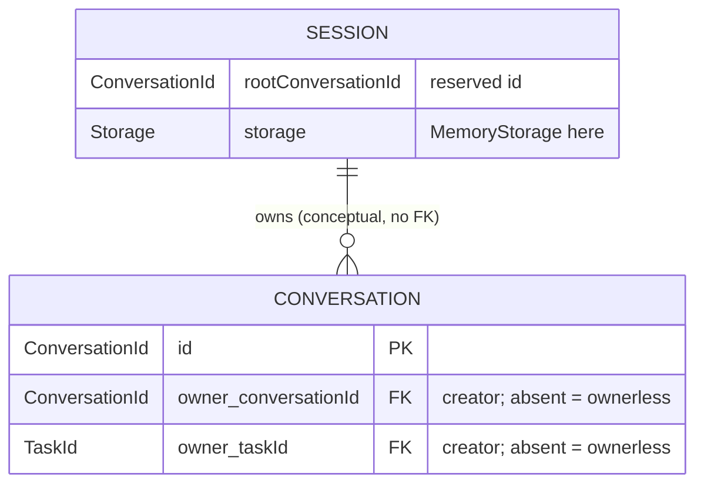
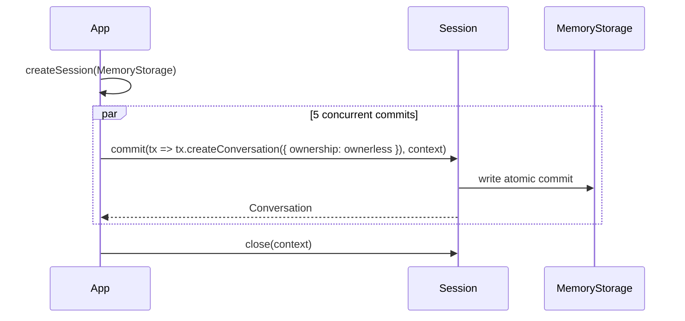

# 00 — Conversation

Create a `Session` over `MemoryStorage` and commit five ownerless conversations
concurrently. Each `session.commit` is a single atomic write to the storage
commit line; the `context` (`BACKGROUND_CONTEXT`) means the operation is never
cancelled.

Entities involved: `Session`, `MemoryStorage`, `Conversation`, `Commit`.

## Model



## Flow



## Run

```shell
source .env
node src/00-conversation/main.mjs
```
