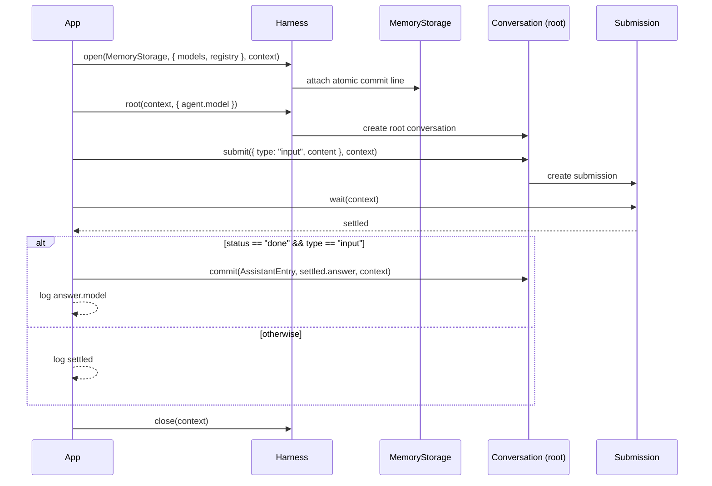

# 000 — Quickstart

End-to-end smoke test: wire up models + provider, open a `Harness` over
`MemoryStorage`, create a root conversation, submit a user input, wait for the
agent to settle, then commit the answer as an `AssistantEntry`.

Entities involved: `Harness`, `MemoryStorage`, `Conversation` (root),
`Submission`, `AssistantEntry`, `Models`/`opencodeProvider`.

## Flow



## Run

```shell
source .env
node src/000-quickstart/main.mjs
```
