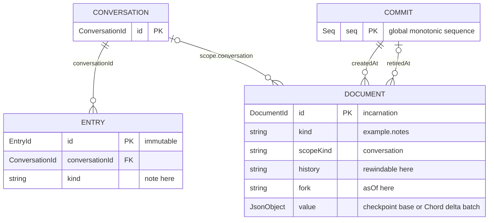

# 01 — Documents

Attach a `Notes` document to a conversation and mutate it inside the same commit
as a transcript `Entry`. Because the doc is `history: "rewindable"`, the value it
held when each entry was written stays readable via `snapshotAsOf`.

Entities involved: `Session`, `Conversation`, `Entry`, `Document` (`defineDoc`),
`Commit`.

## Model



## Snapshot semantics

- `session.snapshot(Notes, id)` — latest value.
- `session.snapshotAsOf(Notes, id, entryId)` — value when that entry was created.

## Run

```shell
source .env
node src/01-documents/main.mjs
```
