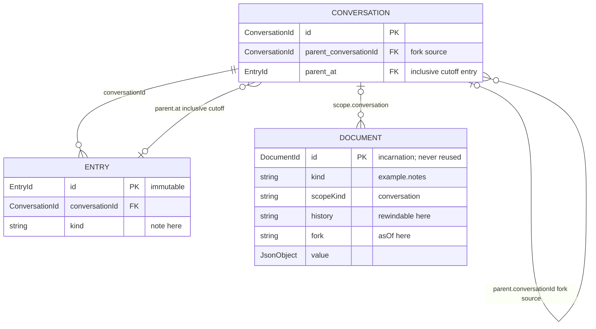
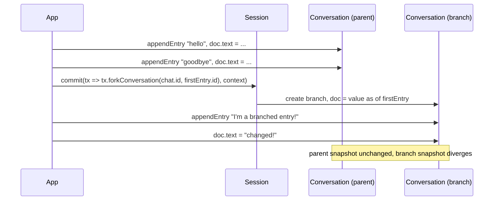

# 02 — Forks

Fork a conversation at a prior entry with `tx.forkConversation(chat.id,
firstEntry.id)`. The fork inherits the document value as of the fork point
(`fork: "asOf"`); subsequent edits on the branch do not touch the parent.

Entities involved: `Session`, `Conversation` (parent + branch), `Entry`,
`Document` (`defineDoc`), `Commit`.

## Model



## Flow



## Run

```shell
source .env
node src/02-forks/main.mjs
```
