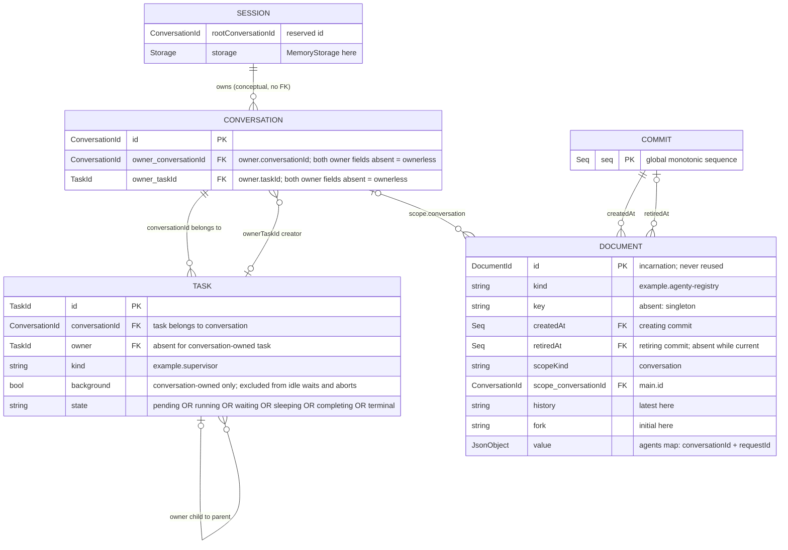
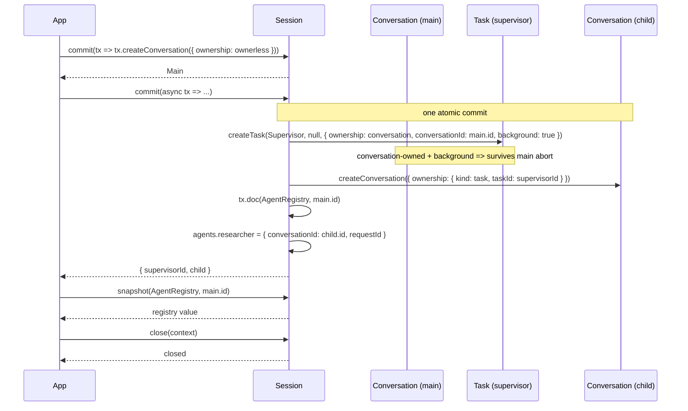

# 03 — Owned conversations

Create an ownerless `main` conversation, then inside one commit create a
background supervisor `Task` scoped to it and a child `Conversation` owned by
that task. An `AgentRegistry` document on `main` records the child conversation
and the request id used to address it.

Ownership rules (pi-durable 1.4.0):

- `tx.createConversation({ ownership })` has 2 ownership kinds
  - `{kind: "ownerless"}` - top-level conversation; `ConversationRecord.owner`
    is absent
  - `{kind: "task", taskId}` - owned by a task; the record stores a composite
    `owner: {conversationId, taskId}` creator edge. Aborting that task aborts
    the work it owns, including this conversation.
- `tx.createTask(definition, input, { ownership, conversationId, background })`
  - `{kind: "conversation"}` - top-level task of a conversation; `TaskRecord.owner`
    is absent and `conversationId` is required when the commit is not bound to a
    conversation
  - `{kind: "task", taskId}` - child task; it must live in its owner task's
    conversation and cannot set `background: true`
- `background: true` is conversation-owned only. It excludes the task from
  ordinary conversation idle waits, conversation aborts, and cascades. An
  ordinary `abort()` leaves it running; `abort(context, { background: true })`
  aborts it too.

Entities involved: `Session`, `Conversation` (`main` + child), `Task`
(`defineTask` supervisor), `Document` (`defineDoc` `AgentRegistry`), `Commit`.

## Model



ERD flattening: `ConversationRecord.owner` is a nested `{conversationId, taskId}`
object (absent for ownerless conversations) and `DocumentRecord.scope` is a
nested `{kind, conversationId}` object; the columns above show the equivalent
flattened/indexed fields.

`AgentRegistry` here uses `checkpointWhen: () => false` (record changes as
deltas), `history: "latest"` and `fork: "initial"`.

## Flow



## Run

```shell
source .env
node src/03-owned-conversations/main.mjs
```
