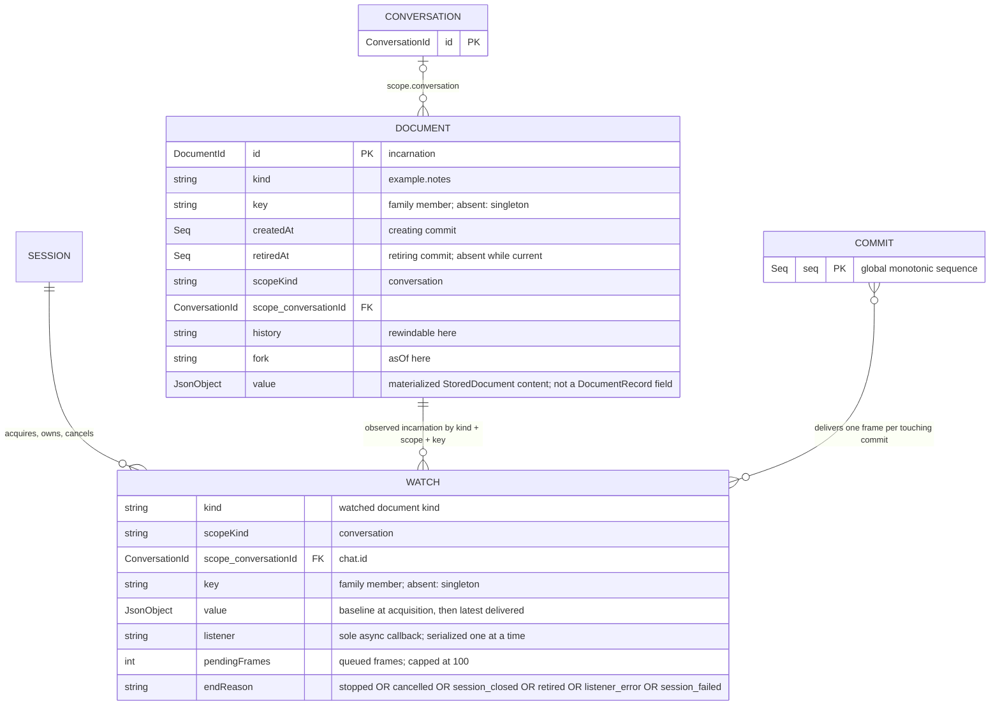
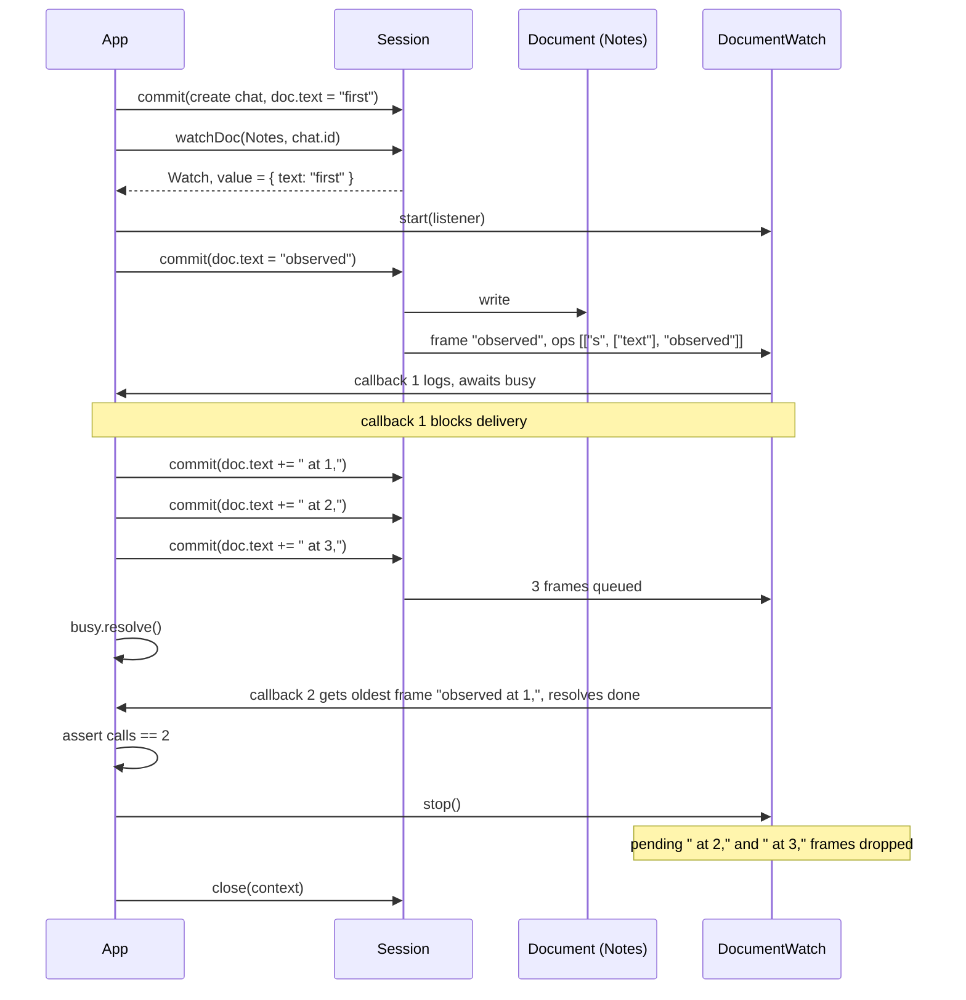

# 04 — Watches

Observe one conversation document without creating it. `session.watchDoc()`
returns `undefined` when the current `Notes` incarnation does not exist, so the
example mutates the doc first. The `DocumentWatch` holds the value at
acquisition, then delivers committed changes one callback at a time.

The example blocks inside the first listener callback. Three later commits queue
their frames, but the second callback resolves `done`; `stop()` then drops every
frame still pending, so the listener runs twice instead of four times.

Entities involved: `Session`, `Conversation`, `Document` (`defineDoc`),
`Commit`, `DocumentWatch` (in-memory `WatchHandle`, not a committed record).

## Model



`WATCH` is a live handle: its address (`kind`, scope, `key`) resolves to the
current `DocumentRecord` incarnation, but it is not stored by a commit.
`DOCUMENT` shows the record fields plus its materialized content; `value` comes
from `StoredDocument`, not from `DocumentRecord` itself.

## Watch semantics

- `watchDoc()` is non-creating: absent or retired document → `undefined`.
- `watch.value` is the committed value at acquisition (here
  `{ text: "first" }`), before `start()`.
- `start()` installs the sole listener and never invokes it inline. Frames are
  delivered in commit order, one callback at a time; a slow callback blocks
  later frames.
- At most 100 undelivered frames are kept. When a frame arrives while 100 are
  pending, they are dropped and replaced with one root-replacement frame
  (`ops: [["r", newestValue]]`).
- `stop()` is idempotent; it drops pending frames. A callback already running
  keeps running.
- `closed` / `stop()` resolve with `stopped`, `cancelled`, `session_closed`,
  `retired` (document value became `null`), `listener_error`, or
  `session_failed`.

## Flow



## Run

```shell
source .env
node src/04-watches/main.mjs
```
